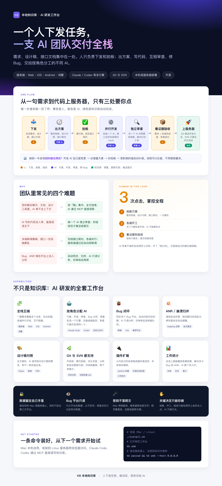

# KB 本地知识库 · AI 研发工作台

> **一个人下发任务，一支 AI 团队交付全栈。**
>
> 需求、设计稿、接口文档集中在一处。人只负责下发和拍板；出方案、写代码、互相审查、修 Bug，交给按角色分工的不同 AI。

`服务端 · Web · iOS · Android · 鸿蒙`　`Claude / Codex 等多引擎`　`Git 与 SVN`　`本机或服务器部署`　`开源`



怎么用见 [使用说明](使用说明.md)。

## 从一句需求到代码上服务器，只有三处要你点

| 步骤 | 做什么 | 谁做 |
|---|---|---|
| 📥 下发 | 丢进需求、设计稿、接口文档 | 🟡 人 |
| 🧭 出方案 | 需求规格、设计对照、接口契约 | 🟣 方案 AI |
| ✅ 拍板 | 看方案，锁定接口契约 | 🟡 人 |
| ⚙️ 并行开发 | 各端一个 AI，接口没好先按契约 mock | 🟣 开发 AI |
| 🔍 独立审查 | 另一个 AI 对照需求挑错，最多打回 2 轮 | 🟣 审查 AI |
| 📦 看证据验收 | 需求 × 各端完成度、审查结论 | 🟡 人 |
| 🚀 上服务器 | Git 推送开发分支，SVN 只提交本次改动 | 🟢 自动 |

🔁 **做到一半发现别的端也得改？** 开发 AI 自己提变更 → 出增量方案 → 你拍板 → 受影响的端自动补做。流程可以反复，不用推倒重来。

## 团队里常见的四个难题

| 难题 | 知识库怎么解决 |
|---|---|
| 资料散在聊天、文档、设计工具里，AI 拿不全上下文 | 按「期」集中，全文检索，AI 通过 MCP 直接读取 |
| AI 写的代码没人审，直接混进主干 | 换一个 AI 独立审查；你验收后才推送或提交 |
| 多端联调靠喊，接口一改各端都乱 | 先锁接口契约，各端并行；服务端通过后自动排联调 |
| Bug、ANR 堆在平台上没人分析 | 自动同步、归并，AI 只读分析，你审核后再修 |

## 3 次点击，掌控全程

1. **拍板方案**：需求规格、设计对照、接口契约，一次看完。
2. **各端开工**：点了才算批准开发，AI 不能替你点。
3. **看证据包验收**：验收后才推送或提交到服务器。

AI 拿不准的会在网页上问你；开了「免打扰」，它就按自己的建议继续做。

## 能力

- 🧩 **全栈五端**：一期需求覆盖多个仓库、多台机器，各端并行开发，互不阻塞。
- 🤖 **按角色分配 AI**：方案、开发、审查、Bug 分析、修复各选一个引擎（Claude Code、Codex、自定义命令），还能按端指定；审查不跟开发用同一个。
- 🐞 **Bug 闭环**：同步多个 Bug 平台（禅道、Jira、崩溃平台），自动归到对应的期；AI 只读分析，你审核后进修复队列。
- 💥 **ANR / 崩溃归并**：用 mapping 自动还原堆栈，按问题归并成批次推进；修完又出现会自动提醒。
- 🎨 **设计稿对照**：出方案时，AI 逐页核对设计稿（Figma、蓝湖、PSD）和需求，不一致的地方先指出来。
- 🌿 **Git 与 SVN 都支持**：开发前、推代码前、切分支前、分析前自动更新代码；冲突就撤销，停下来提示。支持本机仓库和 ssh 远程机器。
- 🔌 **插件扩展**：公司自己的系统做成插件接进来（Jenkins 构建、外部会话拉取、工作统计等），本体保持通用。
- 📊 **工作统计**：在总览看各期进度、解决的 Bug 和 ANR 数量、AI 跑了多少次。

## 安全

- 🔒 **数据留在自己手里**：装在你的 Mac 或服务器上，资料不经过第三方平台。
- 👁️ **Bug 平台只读**：只从平台拉数据，从不回写；修复状态只记在知识库里。
- 🗝️ **密码不落明文**：Mac 用钥匙串，服务器用加密文件；网页要登录，远程连接用令牌。
- ✋ **关键决定只能你做**：拍板、开工、验收只能由你本人在网页上点，AI 不能代点。

## 一条命令装好

需要 macOS 或 Linux、Python 3.9+、git，以及已登录的 [Claude Code](https://claude.com/claude-code)。

```sh
git clone https://github.com/VcStrong/knowledge-base-public.git ~/knowledge-base
cd ~/knowledge-base && ./install.sh          # 装在服务器：./install.sh --host 0.0.0.0 --autostart
kb web                                       # 打开网页工作台 http://127.0.0.1:11555
```

远端部署、换电脑、升级、卸载见 [使用说明 · 安装和部署](使用说明.md#安装和部署)。
